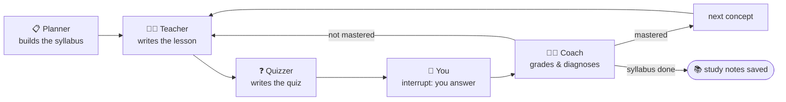

# agent-academy 🎓

A **multi-agent AI tutor** powered by **Claude** ([Anthropic API](https://platform.claude.com)) and [LangGraph](https://github.com/langchain-ai/langgraph). Tell it what you want to learn — LangGraph, reinforcement learning, philosophy, anything — and a team of agents teaches you, quizzes you, and adapts to your gaps.

The LangGraph feature showcased here is **human-in-the-loop**: the graph literally pauses (`interrupt()`) while *you* answer the quiz, then resumes from its checkpoint with your answers.



- **Planner** — turns your topic into a short, ordered syllabus adapted to your level.
- **Teacher** — writes each lesson (analogy + worked example + key takeaways) and saves it to `notes/` as your personal study notebook.
- **Quizzer** — writes open questions that test understanding, not memorization.
- **You** — the graph pauses via `interrupt()` until you answer in the terminal.
- **Coach** — grades your answers (structured output); if a concept isn't mastered, the teacher **re-explains it differently**, targeting exactly the gaps the coach diagnosed.

## Quickstart

```bash
# 1. Get an API key at https://platform.claude.com and export it
export ANTHROPIC_API_KEY=sk-ant-...   # or put it in a local .env file

# 2. Run
uv run agent-academy "LangGraph fundamentals" beginner
uv run agent-academy "the philosophy of Stoicism" curious
ACADEMY_LANGUAGE=français uv run agent-academy "le reinforcement learning" débutant
```

## Configuration

| Variable | Default | Purpose |
|---|---|---|
| `ANTHROPIC_API_KEY` | — | **Required.** Your Anthropic API key (env var or `.env`) |
| `ACADEMY_MODEL` | `claude-opus-4-8` | Any Claude model (e.g. `claude-sonnet-5`, `claude-haiku-4-5`) |
| `ACADEMY_LANGUAGE` | `English` | Language of lessons and quizzes |
| `ACADEMY_CONCEPTS` | `3` | Concepts per study session |
| `ACADEMY_NOTES` | `notes` | Where lesson notes are saved |

## Why it's interesting

- **Human-in-the-loop done properly**: `interrupt()` + checkpointer, not an `input()` buried in a node — the pause/resume survives the graph's state machine.
- **Adaptive loop**: the remediation path re-teaches with a *different* angle driven by the coach's structured diagnosis, capped by `MAX_REMEDIATIONS`.
- **Tangible output**: every session leaves a markdown study notebook in `notes/`.
- **Claude-powered**: lessons and grading benefit from a frontier model's pedagogy — analogies, nuanced feedback, honest grading.

## Project layout

```
src/agent_academy/
├── config.py   # model, language, syllabus size, remediation cap
├── state.py    # AcademyState shared between agents
├── nodes.py    # planner, teacher, quizzer, ask (interrupt), coach
├── graph.py    # LangGraph wiring: quiz loop + remediation loop
└── cli.py      # rich-powered interactive CLI
```

## Roadmap

- [ ] Persistent progress across sessions (SqliteSaver) — resume where you left off
- [ ] Spaced-repetition mode: re-quiz yesterday's weak concepts first
- [ ] Web search tool so lessons can cite fresh sources
- [ ] Web UI (FastAPI + streaming)
